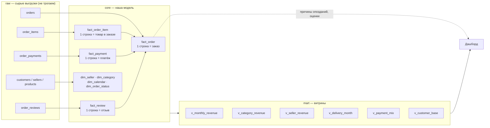
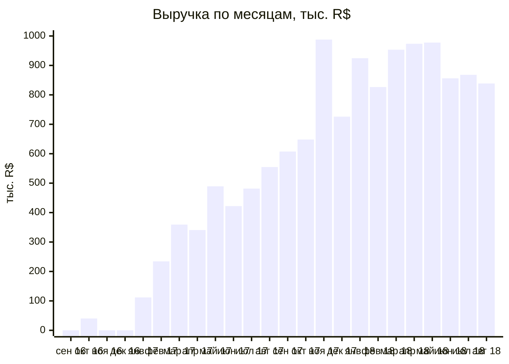
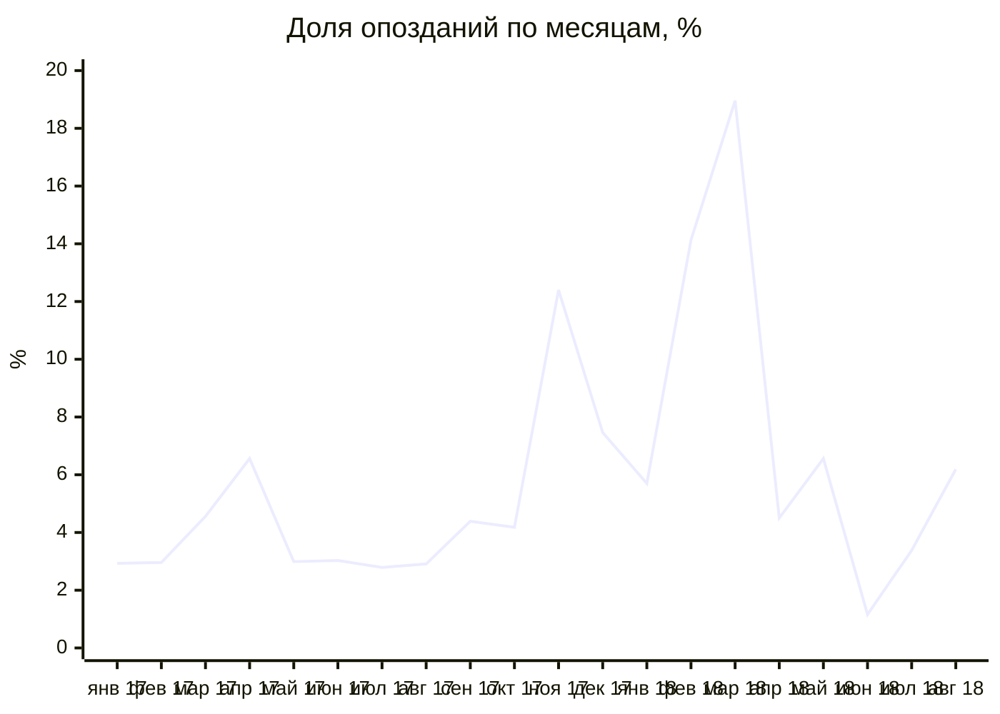
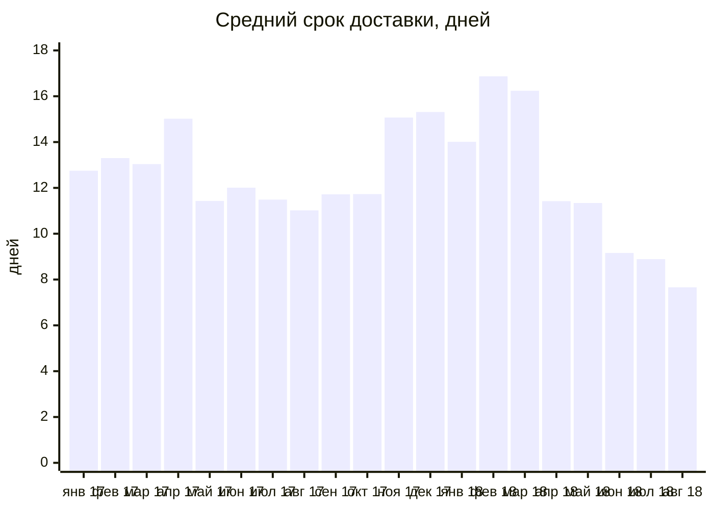
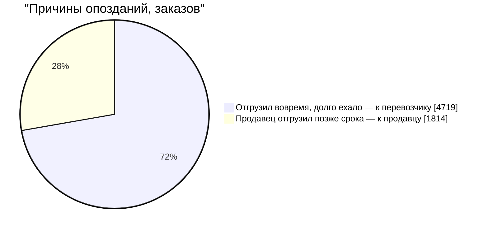
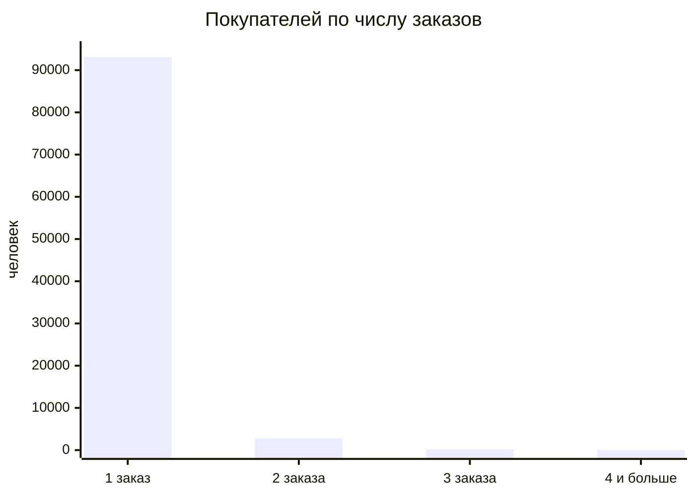
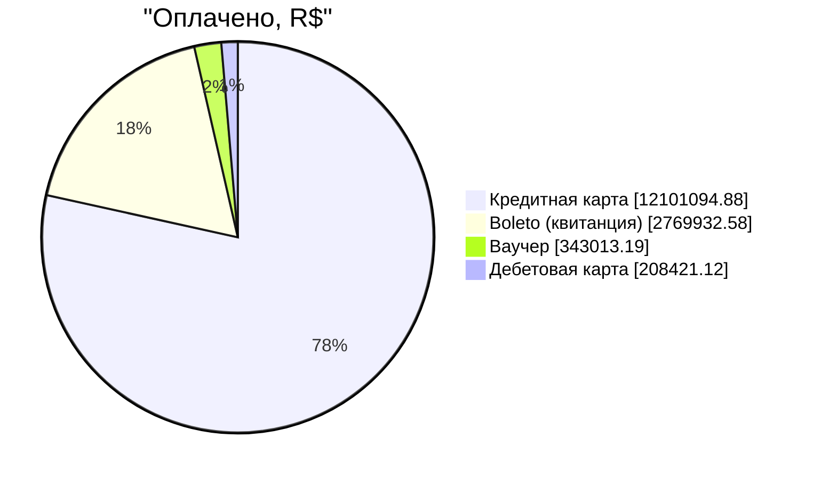

# Дашборд Capibara: продажи и доставка

Внутренний дашборд маркетплейса. Собирать его не нужно — здесь описано, как он
устроен, что показывает и откуда берётся каждая цифра. Все графики ниже построены
на реальных цифрах нашей модели (`core` и `mart`), GitHub рисует их сам.

**Для кого и какие решения:**

| кто смотрит | как часто | какое решение принимает |
|---|---|---|
| Руководитель доставки | каждый день | куда направить людей: перевозчик, отстающие продавцы, пересмотр обещанного срока |
| Руководитель работы с продавцами | раз в неделю | с какими продавцами говорить о сроках отгрузки |
| Коммерческий директор | раз в месяц | какие категории растут, сколько выручки под риском из-за опозданий |

**Главный вывод на сегодня:** продажи выросли и держатся на уровне ~R$ 850–980 тыс.
в месяц, а главный риск — в доставке: опоздавшие заказы получают оценку 2,27 вместо 4,29.

---

## 1. Откуда берутся данные

Дашборд читает только нашу модель. К сырым данным `raw` он не обращается.



**Одно правило на весь дашборд:** выручка — это сумма цен товаров в заказах со
статусом «доставлен», без стоимости доставки. Правило записано в одном месте —
`core.dim_order_status.is_revenue`, поэтому все блоки считают выручку одинаково.

---

## 2. Как выглядит экран

```text
┌────────────────────────────────────────────────────────────────────────────┐
│ Capibara — операционный дашборд        [Продажи][Доставка][Продавцы][...]  │
│ Фильтры: [Месяц ▾]  [Штат продавца ▾]  [Категория ▾]                        │
├────────────┬────────────┬────────────┬────────────┬────────────┬───────────┤
│ Выручка    │ Заказы     │ Средний    │ Покупатели │ Опоздания  │ Оценка    │
│ R$ 13,2 млн│ 96 478     │ чек 159,88 │ 96 096     │ 6,77%      │ 4,16      │
├────────────┴────────────┴────────────┴────────────┴────────────┴───────────┤
│ ПРОДАЖИ    [ столбцы: выручка по месяцам ]  [ топ категорий ] [ отчёт ]    │
├────────────────────────────────────────────────────────────────────────────┤
│ ДОСТАВКА   [ линия: % опозданий ] [ кто виноват ] [ оценки и деньги ]      │
├────────────────────────────────────────────────────────────────────────────┤
│ ПРОДАВЦЫ   [ топ-20 продавцов ]   [ опоздания по штатам ]                   │
├────────────────────────────────────────────────────────────────────────────┤
│ ПОКУПАТЕЛИ [ заказов на человека ] [ способы оплаты ]                      │
├────────────────────────────────────────────────────────────────────────────┤
│ КАК ЧИТАТЬ: какие числа нельзя складывать, откуда данные                   │
└────────────────────────────────────────────────────────────────────────────┘
```

---

## 3. Главные цифры (верхняя строка)

Период — сентябрь 2016 – август 2018, только доставленные заказы.

| показатель | значение | как считается | уровень | откуда |
|---|---:|---|---|---|
| Выручка | R$ 13 221 498 | `sum(goods_total)` где `is_revenue` | заказ | `core.fact_order` |
| Доставленные заказы | 96 478 | `count(*)` где `is_revenue` | заказ | `core.fact_order` |
| Средний чек | R$ 159,88 | `avg(order_total)` — товары + доставка | заказ | `core.fact_order` |
| Покупатели (люди) | 96 096 | число разных `customer_unique_id` | человек | `mart.v_customer_base` |
| Вернулись за 2-й покупкой | 3,12% | люди с 2+ заказами ÷ все люди | человек | `mart.v_customer_base` |
| Доля опозданий | 6,77% | опоздавшие ÷ доставленные с известной датой вручения | заказ | `core.fact_order` |
| Средняя оценка | 4,16 | `avg(review_score_avg)` | заказ | `core.fact_order` |

---

## 4. Продажи

### Выручка по месяцам, тыс. R$

Ноябрь 2016 в отчёте есть, с нулём: заказов в нём не было, а витрина строится от
календаря (`core.dim_calendar`), поэтому месяц не пропадает.



Источник: `mart.v_monthly_revenue`. Сумма 24 месяцев — 13 221 498,11.

### Топ-10 категорий по выручке

| # | категория | выручка, R$ | доля | штук |
|---:|---|---:|---:|---:|
| 1 | health_beauty | 1 233 131,72 | 9,33% | 9 465 |
| 2 | watches_gifts | 1 166 176,98 | 8,82% | 5 859 |
| 3 | bed_bath_table | 1 023 434,76 | 7,74% | 10 953 |
| 4 | sports_leisure | 954 852,55 | 7,22% | 8 431 |
| 5 | computers_accessories | 888 724,61 | 6,72% | 7 644 |
| 6 | furniture_decor | 711 927,69 | 5,38% | 8 160 |
| 7 | housewares | 615 628,69 | 4,66% | 6 795 |
| 8 | cool_stuff | 610 204,10 | 4,62% | 3 718 |
| 9 | auto | 578 966,65 | 4,38% | 4 140 |
| 10 | toys | 471 286,48 | 3,56% | 4 030 |

Источник: `mart.v_category_revenue`. На дашборде — полный отчёт по всем 74 категориям
с поиском и сортировкой. Товары без категории собраны в `not_available`, поэтому
сумма по категориям равна всей выручке.

---

## 5. Доставка

### Доля заказов, приехавших позже обещанного, %

Опоздания идут **скачками, а не растут постепенно**: обычно 3–6%, но ноябрь 2017,
февраль и март 2018 — провалы до 19%. Дашборд нужен, чтобы такой месяц было видно
в тот же день.



Источник: `mart.v_delivery_month` (`delayed_pct`). В знаменателе — заказы, у которых
известна дата вручения: у 8 доставленных её нет.

### Средний срок доставки по месяцам, дней



Источник: `mart.v_delivery_month` (`avg_delivery_days`). С апреля 2018 срок заметно сократился.

### Кто виноват в опоздании

Из 6 534 опоздавших заказов:



Как считаем: если заказ передали в доставку (`fact_order.carrier_at`) позже срока
отгрузки продавца (самый ранний `fact_order_item.shipping_limit_date` в заказе), виноват
продавец; иначе — дорога. Один заказ без даты передачи в доставку не учтён.

**Вывод:** в 72% опозданий виновата доставка, а не продавцы — чинить в первую очередь её.

### Чем оборачивается опоздание

| | привезли вовремя | с опозданием |
|---|---:|---:|
| заказов | 89 936 | 6 534 |
| средняя оценка | **4,29** | **2,27** |
| отзывов на 1–2 звезды | 9,23% | 62,36% |
| выручка, R$ | 12 234 324,59 | 985 924,34 |

Выручка в опоздавших заказах — 7,5% всей выручки. Это верхняя граница того, что под
риском: не все эти покупатели уйдут. Источник: `core.fact_order` (`is_delayed`,
`review_score_avg`, `goods_total`).

---

## 6. Продавцы

### Топ-10 продавцов по выручке

| # | продавец | город | штат | заказы | штук | выручка, R$ |
|---:|---|---|---|---:|---:|---:|
| 1 | `4869f7a5…` | guariba | SP | 1 124 | 1 148 | 226 987,93 |
| 2 | `53243585…` | lauro de freitas | BA | 348 | 400 | 217 940,44 |
| 3 | `4a3ca931…` | ibitinga | SP | 1 772 | 1 949 | 196 882,12 |
| 4 | `fa1c13f2…` | sumare | SP | 578 | 579 | 190 917,14 |
| 5 | `7c67e144…` | itaquaquecetuba | SP | 973 | 1 355 | 186 570,05 |
| 6 | `7e93a43e…` | barueri | SP | 319 | 322 | 165 981,49 |
| 7 | `da8622b1…` | piracicaba | SP | 1 311 | 1 548 | 159 816,87 |
| 8 | `7a67c85e…` | sao paulo | SP | 1 145 | 1 155 | 139 658,69 |
| 9 | `1025f0e2…` | sao paulo | SP | 910 | 1 420 | 138 208,56 |
| 10 | `955fee92…` | sao paulo | SP | 1 261 | 1 472 | 131 836,71 |

Источник: `mart.v_seller_revenue`. Выручка продавца — **только его товары**: в одном
заказе бывают товары разных продавцов, поэтому считаем по `fact_order_item`, а не по заказу.

### Опоздания по штату продавца

Сортируем по **числу** опоздавших заказов, а не по доле: большой процент на маленьком
объёме срочных решений не требует (у MA 19%, но это всего 74 заказа).

| штат | заказы | выручка, R$ | опоздали | доля опозданий |
|---|---:|---:|---:|---:|
| SP | 68 641 | 8 509 511 | 5 016 | 7,31% |
| PR | 7 512 | 1 232 097 | 402 | 5,35% |
| MG | 7 735 | 977 866 | 371 | 4,80% |
| RJ | 4 227 | 820 612 | 301 | 7,12% |
| SC | 3 603 | 613 592 | 175 | 4,86% |
| MA | 389 | 36 098 | 74 | 19,02% |
| RS | 1 962 | 373 412 | 61 | 3,11% |
| DF | 808 | 94 840 | 43 | 5,32% |

Источник: `core.fact_order` + `core.fact_order_item` + `core.dim_seller`.

---

## 7. Покупатели и оплата

### Сколько заказов делает один человек

Человека определяем по `customer_unique_id`. Поле `customer_id` новое у каждого
заказа — если считать по нему, «покупателей» получится 99 441, и повторных не будет вовсе.



Источник: `mart.v_customer_base`. Вернулись за второй покупкой 2 997 человек — 3,12%.

### Способы оплаты, сумма платежей



Источник: `mart.v_payment_mix`. Сумма платежей больше выручки: в неё входят доставка
и проценты по рассрочке.

---

## 8. Какие числа нельзя складывать по срезам

| показатель | почему нельзя складывать | как правильно |
|---|---|---|
| Доля опозданий, доля отзывов 1–2, доля возвратов покупателей | у каждого среза свой знаменатель | сложить числители, сложить знаменатели, потом разделить |
| Средний чек, средний срок, средняя оценка | у срезов разный объём: среднее средних ≠ общее среднее | пересчитать по исходным строкам |
| Медиана срока доставки | медианы по месяцам не дают медиану за год | пересчитать по всем заказам |
| Число заказов по категориям | сумма по 74 категориям = 97 276, а заказов 96 478: в 780 заказах товары разных категорий | считать `count(distinct order_id)` по нужному срезу |
| Число заказов по продавцам и по способам оплаты | один заказ — несколько продавцов или платежей | так же, `count(distinct order_id)` |

**Складывать можно только деньги и штуки.**

---

## 9. Чего дашборд не показывает

- **Причины задержки.** В данных нет перевозчика и пути посылки — только 4 отметки
  времени (оформлен, оплачен, передан в доставку, вручён).
- **Возвраты** уже доставленных заказов — в выгрузке их нет.
- **Живые данные.** Выгрузка заканчивается августом 2018; при ежедневной загрузке
  верхние цифры стоит показывать за последние 30 дней со сравнением с прошлым периодом.

---

## 10. Как пересчитать любую цифру

Собрать модель и получить все витрины:

```bash
bash scripts/setup.sh     # база и сырые данные
bash model/build.sh       # core → mart → ответы → проверки
```

Примеры запросов, из которых взяты блоки:

```sql
-- главные цифры
select count(*) as orders, sum(goods_total) as revenue, avg(order_total) as avg_check
from core.fact_order where is_revenue;

-- доля опозданий по месяцам
select month_start, delayed_pct, avg_delivery_days from mart.v_delivery_month order by 1;

-- кто виноват в опоздании
with x as (
  select o.order_id, o.carrier_at, min(i.shipping_limit_date) as limit_at
  from core.fact_order o
  join core.fact_order_item i on i.order_id = o.order_id
  where o.is_revenue and o.is_delayed
  group by 1, 2
)
select case when carrier_at > limit_at then 'продавец' else 'доставка' end as cause, count(*)
from x where carrier_at is not null group by 1;

-- оценки: вовремя и с опозданием
select is_delayed, count(*), round(avg(review_score_avg), 2) as avg_score
from core.fact_order where is_revenue and is_delayed is not null group by 1;
```
