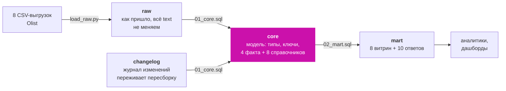
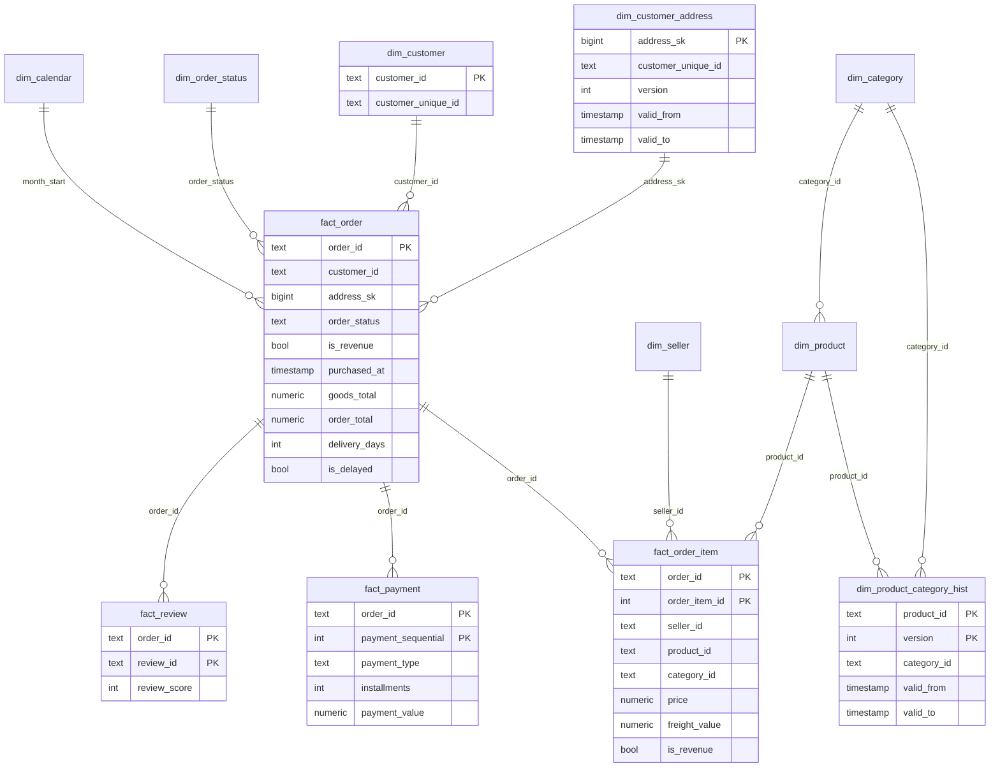
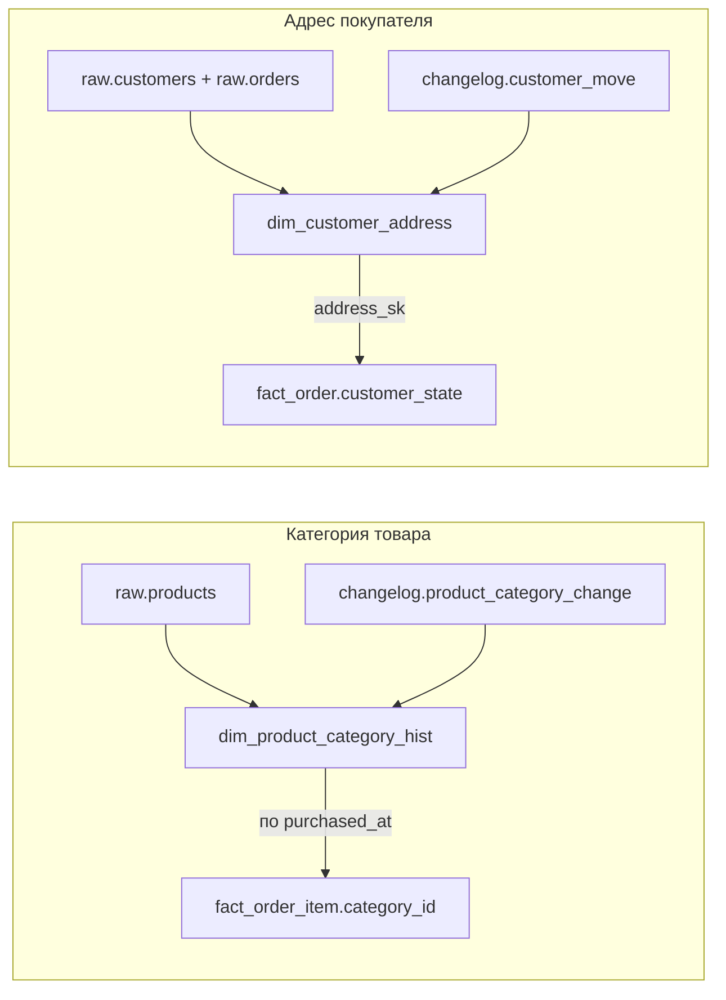
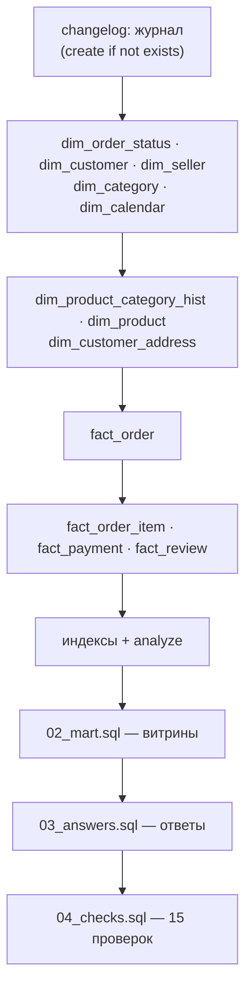

# Архитектура базы данных Capibara

Как устроена база: какие в ней схемы, какие таблицы, что значит одна строка
каждой таблицы, как таблицы связаны и в каком порядке собираются. Код —
в `01_core.sql` (модель) и `02_mart.sql` (витрины).

---

## 1. Четыре схемы



| схема | что хранит | кто пишет | пересобирается? |
|---|---|---|---|
| `raw` | 8 таблиц из CSV как есть, все колонки `text` | `scripts/load_raw.py` | нет, только загрузка |
| `changelog` | журнал изменений: смены категорий, переезды покупателей | функции `changelog.*` | **нет** — `create table if not exists`, без `drop` |
| `core` | модель: факты и справочники с типами и ключами | `01_core.sql` | да, целиком с нуля при каждой сборке |
| `mart` | витрины (view) и сохранённые ответы `answer_q1…q10` | `02_mart.sql`, `03_answers.sql` | да |

**Главное правило:** `core` всегда строится из `raw` + `changelog`. Поэтому
сборка повторяема: на чистой базе и на перезапущенной результат одинаковый,
а история изменений не теряется.

---

## 2. Схема «звезда» в core



Связи логические: внешних ключей (`references`) в базе нет, целостность
проверяет `04_checks.sql` (15 проверок). Так модель пересобирается быстрее и
не падает на одной «осиротевшей» строке, а потери видны в отчёте проверок.

---

## 3. Факты — что случилось

**Зерно** — что означает одна строка. Это главное, что нужно знать о таблице
перед любым расчётом.

| таблица | одна строка — это | строк | ключ |
|---|---|---:|---|
| `fact_order` | **один заказ** | 99 441 | `order_id` |
| `fact_order_item` | **один товар одного продавца в заказе** | 112 650 | `(order_id, order_item_id)` |
| `fact_payment` | один способ оплаты заказа | 103 886 | `(order_id, payment_sequential)` |
| `fact_review` | один отзыв о заказе | ≈ 99 тыс. | `(order_id, review_id)` |

### `fact_order` — заказ целиком

Сюда сведены суммы со всех позиций, платежей и отзывов заказа, поэтому
**средний чек считается здесь** (159.88).

| группа колонок | колонки |
|---|---|
| ключи | `order_id`, `customer_id`, `customer_unique_id`, `address_sk` |
| адрес на момент заказа | `customer_city`, `customer_state` |
| статус | `order_status`, `is_revenue` |
| хронология | `purchased_at`, `approved_at`, `carrier_at`, `delivered_at`, `estimated_delivery_date`, `month_start` |
| деньги | `items_count`, `goods_total` (товары), `freight_total` (доставка), `order_total` (всё), `paid_total` |
| оплата и отзыв | `payment_types`, `max_installments`, `review_score_avg` |
| доставка | `delivery_days`, `is_delayed` |

775 заказов без позиций остаются здесь с нулями: позиции подклеены `left join`.

### `fact_order_item` — товар в заказе

**Выручка продавцов и категорий считается здесь**: в одном заказе могут быть
товары разных продавцов и категорий. Колонки: `seller_id`, `product_id`,
`category_id` и `display_category` (категория **на момент покупки**), город и
штат продавца, `purchased_at`, `month_start`, `price`, `freight_value`,
`item_total`, `shipping_limit_date`, `is_revenue`.

`order_item_id` — номер позиции внутри заказа (1, 2, 3), поэтому ключ только
парный. Колонки количества в данных нет: одна строка = одна единица товара.

### `fact_payment` и `fact_review`

* `fact_payment` — заказ можно оплатить несколькими способами сразу, их
  различает `payment_sequential`.
* `fact_review` — `review_id` не уникален (один отзыв бывает на двух заказах),
  поэтому ключ составной; у 547 заказов несколько отзывов, в `fact_order`
  лежит средний балл.

---

## 4. Справочники — по чему режем

| таблица | одна строка — это | строк | ключ | заметка |
|---|---|---:|---|---|
| `dim_order_status` | статус заказа | 8 | `order_status` | `is_revenue = true` только у `delivered` — **правило выручки живёт здесь** |
| `dim_customer` | покупатель в конкретном заказе | 99 441 | `customer_id` | `customer_unique_id` — человек, по нему считаем людей (96 096) |
| `dim_customer_address` | версия адреса человека | 96 355 | `address_sk` | SCD2, см. раздел 5 |
| `dim_seller` | продавец | 3 095 | `seller_id` | без истории адреса |
| `dim_category` | категория | 74 | `category_id` | 73 настоящих + `not_available`; имя — английское, если нет перевода — португальское |
| `dim_product_category_hist` | версия категории товара | ≥ 32 951 | `(product_id, version)` | SCD2, см. раздел 5 |
| `dim_product` | карточка товара | 32 951 | `product_id` | текущая категория — для каталога, не для отчётов |
| `dim_calendar` | день | 774 | `calendar_date` | отчёты по месяцам строятся от него, чтобы не пропал пустой ноябрь 2016 |

---

## 5. История изменений (SCD2)

Задача из вброса: смена категории товара и переезд покупателя не должны
менять прошлые отчёты.

**Как хранится.** У каждой версии есть период действия `[valid_from, valid_to)`.
Первая версия начинается с `-infinity`, текущая заканчивается `infinity` и
помечена `is_current`. Факт берёт ту версию, в период которой попало время
покупки.



Пример версий категории:

| product_id | version | category_id | valid_from | valid_to | is_current |
|---|---:|---|---|---|---|
| товар A | 1 | toys | −∞ | 2018-03-15 | false |
| товар A | 2 | baby | 2018-03-15 | ∞ | true |

Заказ от февраля 2018 попадает в версию 1 и остаётся в `toys`.

* **Переезды в данных уже есть:** адрес в `raw.customers` записан на каждый
  заказ, и у 252 человек он меняется между заказами. Подряд идущие одинаковые
  адреса склеиваются в одну версию.
* **Новые изменения** вносятся функциями, которые пишут в журнал и сразу
  обновляют `core`:
  * `changelog.change_product_category(product_id, category_id, changed_at, comment)`
  * `changelog.move_customer(customer_unique_id, city, state, zip, moved_at)`
* **Почему отдельная схема:** `01_core.sql` удаляет и создаёт `core` заново.
  Журнал в `changelog` пересборка не трогает, поэтому история не стирается.

---

## 6. Витрины mart

Витрины — это `view` поверх `core`: данные не копируются, всегда актуальны.

| витрина | на что отвечает | зерно |
|---|---|---|
| `v_monthly_revenue` | выручка и заказы по месяцам, от календаря | месяц |
| `v_seller_revenue` | выручка, заказы и единицы продавца | продавец |
| `v_category_revenue` | выручка по категориям | категория |
| `v_customer_base` | первый/последний заказ, число заказов, выручка человека | человек |
| `v_delivery_month` | просрочки, срок доставки и оценка по месяцам | месяц |
| `v_payment_mix` | способы оплаты по месяцам | месяц × способ |
| `v_order_status` | воронка статусов, заказы без позиций | статус |
| `v_delivery_state` | срок доставки и опоздания по штату (на момент заказа) | штат |

Ответы на вопросы сохранены таблицами `mart.answer_q1 … mart.answer_q10`.

---

## 7. Сквозные правила модели

| правило | где записано | зачем |
|---|---|---|
| Выручка = `price` по `delivered`, без доставки | `dim_order_status.is_revenue` → флаг в фактах | одно определение на все отчёты |
| Типы приводятся через `nullif(btrim(x), '')::тип` | весь `01_core.sql` | пустая строка → `NULL`, загрузка не падает |
| Где терять нельзя — `left join` | сборка фактов | заказы без позиций и платежей не пропадают |
| Чек — по `fact_order`, продавцы и категории — по `fact_order_item` | зерно таблиц | 159.88, а не 139.97 |
| Людей считаем по `customer_unique_id` | `dim_customer`, `v_customer_base` | 96 096, а не 99 441 |
| Категория и адрес — на момент покупки | SCD2-таблицы | прошлые отчёты не меняются |

---

## 8. Порядок сборки



Всё запускает одна команда:

```bash
bash model/build.sh
```

**Индексы** стоят на колонках, по которым режут отчёты: `month_start`,
`customer_unique_id`, `customer_state` в `fact_order`; `seller_id`,
`category_id`, `product_id`, `month_start` в `fact_order_item`; `review_score`;
текущая версия адреса (`where is_current`).

---

## 9. Чего в модели сознательно нет

| чего нет | почему | когда появится |
|---|---|---|
| Внешних ключей | быстрая пересборка, целостность — в проверках | при переходе на инкрементальную загрузку |
| Истории адреса продавца | в данных нет переездов продавцов | тем же SCD2, по первому поводу |
| Истории статусов заказа | в выгрузке только последний статус | `fact_order_status` с событиями переходов |
| Возвратов | их нет в выгрузке | `fact_return` на уровне позиции |
| Числовых суррогатных ключей у фактов | на 112 тыс. строк разницы нет | до роста объёма, см. `STRATEGY.md` |
