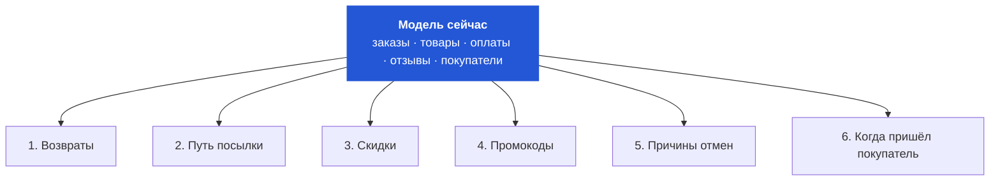
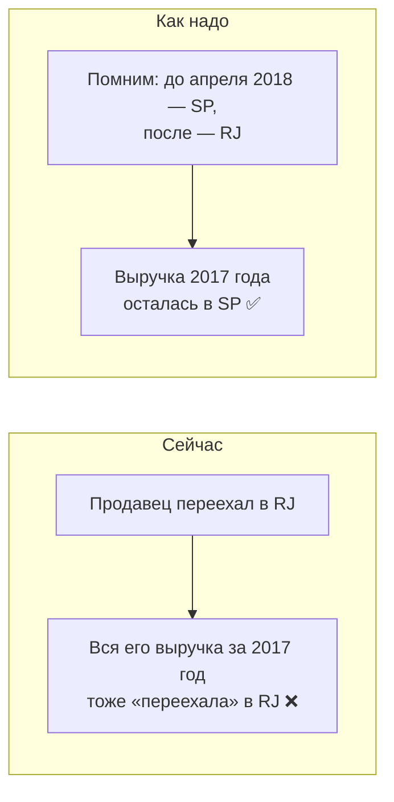
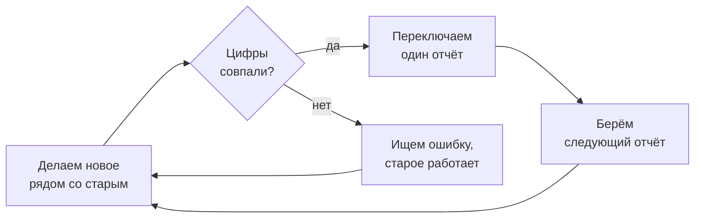

# Как будет развиваться наша модель

Коротко: **сейчас всё работает быстро, и запаса хватит надолго.** Менять что-то
нужно только тогда, когда появится реальная проблема. Ниже — какие проблемы
появятся, в каком порядке и что мы тогда сделаем.

---

## 1. План в одной картинке

Подпись на стрелке — это **повод** перейти к следующему шагу. Нет повода — не переходим.

| шаг | что делаем | инструмент |
|---|---|---|
| Сейчас | одна база, модель пересобирается целиком за секунды | PostgreSQL |
| Шаг 1 | модель обновляется сама каждый день, пересчитываются только новые данные, проверки запускаются автоматически | dbt + Airflow |
| Шаг 2 | для отчётов заводим отдельную базу, которая очень быстро считает суммы по огромным таблицам | ClickHouse |
| Шаг 3 | аналитик пишет запрос в одно место и не думает, в какой базе лежат данные | Trino |

---

## 2. Какие данные добавятся

Сейчас модель знает про заказы, товары в заказе, оплаты, отзывы и покупателей.
Вот чего не хватает — по порядку важности:

| # | что добавим | зачем |
|---:|---|---|
| 1 | **Возвраты** | сейчас доставленный заказ считается выручкой навсегда, даже если товар вернули |
| 2 | **Путь посылки** | видеть не только «опоздал», но и где именно застрял: у продавца, на складе, в дороге |
| 3 | **Скидки** | понимать, выросли продажи из-за распродажи или потому что товар правда нужен |
| 4 | **Промокоды** | считать, сколько принесла каждая акция |
| 5 | **Причины отмен** | понять, почему 625 заказов отменили и 609 не нашлось в наличии |
| 6 | **Когда пришёл покупатель** | следить, сколько людей возвращаются. Сейчас только 3,12% — это главный вопрос бизнеса |

---

## 3. Где важно помнить прошлое

Сейчас модель хранит только **последнее** значение. Из-за этого старые отчёты
могут незаметно поменяться.

**Пример.** Продавец из штата SP в 2018 году переехал в RJ:

Где ещё так бывает:

| что меняется | что ломается | что делаем |
|---|---|---|
| адрес продавца | выручка «переезжает» в другой штат | храним все адреса с датами |
| категория товара | меняется отчёт по категориям за прошлые годы | запоминаем категорию в момент продажи (уже сделано) |
| статус заказа | вчерашний отчёт о выручке завтра покажет другую цифру | храним, когда и в какой статус переходил заказ |

Что из этого уже сделано в `model/05_history.sql`: адрес покупателя, адрес продавца
и категория товара хранятся версиями с `valid_from`, `valid_to` и `is_current`, а
заказ соединяется с той версией, которая действовала в его дату. Поэтому прошлые
отчёты не меняются, даже если продавец переписал категорию, а покупатель переехал.
Инварианты держат проверки `model/07_checks_b.sql`: одна действующая версия на
ключ, промежутки версий не пересекаются, каждый заказ и каждая позиция получают
ровно одну версию, выручка через историю категорий равна выручке блока А.
Следующий шаг — `seller_sk`, суррогатный ключ версии прямо в `fact_order_item`,
чтобы соединение не зависело от точности даты заказа. Разбор с примерами переездов —
в `model/HISTORY.md`.

---

## 4. Что начнёт тормозить первым

Когда данных станет в сотни раз больше, проблемы появятся примерно в таком порядке:

| # | проблема | решение |
|---:|---|---|
| 1 | посчитать, сколько **разных** людей купили, — самый медленный запрос | считать заранее, раз в день |
| 2 | каждый раз, когда кто-то открывает дашборд, всё пересчитывается заново | хранить готовые итоги по месяцам |
| 3 | номера заказов — длинные строки из 32 символов, они занимают место и замедляют поиск | заменить их внутри модели на обычные числа |
| 4 | модель каждый раз собирается с нуля, на больших объёмах это часы | пересчитывать только новые месяцы |
| 5 | загрузка данных и десятки людей с дашбордами мешают друг другу | сделать отдельную копию базы только для чтения |

---

## 5. Сколько ещё выдержит PostgreSQL

| | сейчас | выдержит |
|---|---:|---:|
| строк с товарами в заказах | 112 тысяч | 100–300 миллионов |

То есть **запас примерно в 1000 раз**. Поэтому базу не меняем, пока не дойдём
до шага 2.

**Почему потом ClickHouse, а не что-то другое:** нам нужно быстро складывать
и считать большие таблицы — именно это ClickHouse умеет лучше всего, и
небольшая команда справится с его поддержкой.

---

## 6. Как переходить, чтобы ничего не сломать

Три правила:

1. **По одному отчёту, а не всё сразу.** Старый отчёт работает, пока новый не проверен.
2. **Сначала сверяем цифры.** Те же проверки, что в `04_checks.sql`, запускаем на старой
   и новой системе. Не совпало — не переключаем.
3. **Одна главная база по деньгам.** PostgreSQL остаётся «последней правдой».
   Новые базы только берут из неё данные.

| что может пойти не так | как защищаемся |
|---|---|
| новая система считает чуть иначе, и у аналитиков снова «разные цифры» | правило 2: сверка перед переключением |
| переключили всё сразу, один отчёт оказался неверным, и перестали верить всем | правило 1: по одному отчёту |
| непонятно, какой базе верить | правило 3: главная — PostgreSQL |
| поставили новые инструменты, а объём не вырос — лишняя работа | переходим к шагу только по поводу (раздел 1) |
